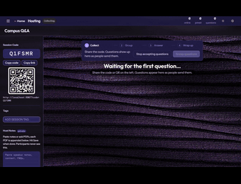
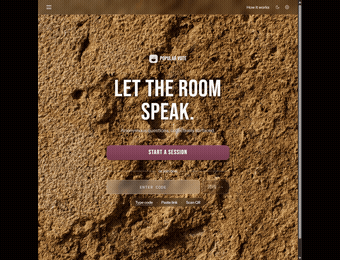
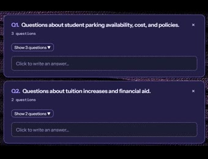
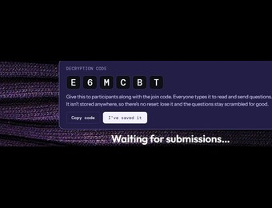
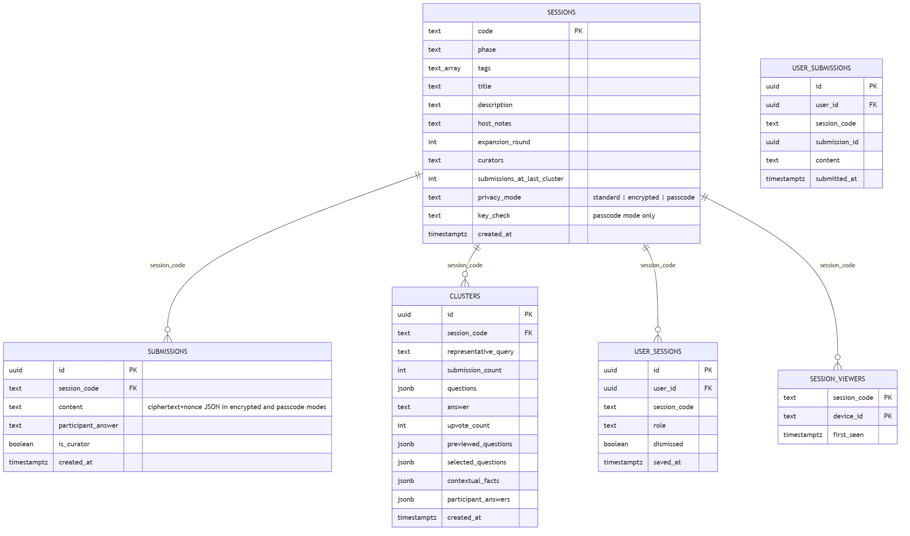

# CISC-4900-PopularVote

## Project overview
PopularVote is a web application for anonymous question submission and real-time clustering. A session host gathers questions from a group, the app groups the questions by topic using AI, and the host answers the grouped questions.

## Core functionality
A participant submits a question without an account and without giving a name. The app groups similar submissions into clusters using Google Gemini, and the host or a promoted curator answers each cluster. Participants can upvote a question and see responses live over a WebSocket connection, so everyone sees the same state as it changes.

A host can also upload notes as a PDF before or during a session. The app uses the notes to suggest answers and to run a chat flow, a form of retrieval augmented generation (RAG) where the model answers from the uploaded notes instead of from general knowledge alone.

Each session picks one of three privacy modes when it starts. In a Standard session, the server can read the questions, so the AI can group them and suggest answers. In an Encrypted session, the questions and the grouping stay in the participant's and host's browsers, and the server only relays ciphertext it cannot read. A Passcode session is encrypted the same way, but the key comes from a 6 character passcode the host shares instead of being handed out by the host's browser, so participants can join even when the host is offline. In both encrypted modes each participant reaches the server only as a hash that is different in every session, so one device cannot be linked across two sessions.

After a session ends, the host can download a PDF summary of the results.

## Screenshots
All screenshots are in dark mode. These six show the parts that matter most. The rest are in [documents/screenshots](documents/screenshots/), which holds full size screens for every step, small close up crops and more GIFs. A short [index](documents/screenshots/README.md) there says what each file shows.

<table>
<tr>
<td width="240"></td>
<td>

**A whole session, step by step.** Questions arrive, the host clicks "Group questions" and the AI sorts them into topics, the host answers one, then finishes the session. A bar at the top shows the four stages (Collect, Group, Answer, Wrap up) and always offers the next step as one button. Participants see the same bar, read only.

</td>
</tr>
<tr>
<td width="240"></td>
<td>

**Three privacy modes.** The host picks one when starting a session. Standard lets the AI group questions and suggest answers. Encrypted means only the room can read them, with no AI. Passcode is encrypted too, unlocked with a code the host shares.

</td>
</tr>
<tr>
<td width="240"></td>
<td>

**Joining and asking.** A participant types the session code (or scans the QR code), lands on the question screen and sends a question. No account, email or password is asked for.

</td>
</tr>
<tr>
<td width="240"></td>
<td>

**Topic cards.** Each card shows a short sentence the AI wrote for a group of similar questions, how many landed in it, the questions themselves, and an answer box for the host.

</td>
</tr>
<tr>
<td width="240"></td>
<td>

**Passcode.** In a Passcode session the host is shown a 6 character code once. It is never stored, so losing it scrambles the questions for good.

</td>
</tr>
<tr>
<td width="240"></td>
<td>

**Session summary.** When the session ends, every topic, its top questions and the host's answers are collected on one page that can be downloaded as Markdown or PDF.

</td>
</tr>
</table>

## Technology
The repository is split into `src/frontend` and `src/backend`.

The frontend uses React 19 and Vite, with `socket.io-client` for live updates, `@supabase/supabase-js` for the database connection, `html5-qrcode` and `qrcode` for QR code session joins, and `jspdf` for the PDF export.

The backend uses Python and Flask, with `Flask-SocketIO` running on `eventlet` for the live events, `Flask-Limiter` for rate limiting, `google-genai` for the clustering and chat features, and `pypdf` to read the host's uploaded notes. The backend runs in production under `gunicorn`.

The database is PostgreSQL through Supabase, and it stores sessions (with their privacy mode), submissions, clusters, and a per-session device count. `src/backend/database/migrations/2026-11-26_privacy_mode.sql` brings an older database up to date. The backend keeps an in-memory cache that it reads from and writes through to the database, so the database stays the source of truth.

The schema script and its notes are in `documents/design_documents/PostgreSQL Schema.sql` and `PostgreSQL Schema.md`.

The backend was first built on Node.js and Express, and it was later rewritten in Python and Flask so the AI tools, the PDF tools, and the WebSocket server could run on one runtime instead of two. The full design history and the reasoning behind that change are in `documents/design_documents/`.

## Deployment
The frontend deploys as a static build on Render's free tier, and the backend runs separately on Railway. Both run on a free or low-cost tier, so the first request after a period with no traffic can be slow while the service wakes back up.

## Getting started
First, clone the repository. Second, copy `src/backend/.env.example` to `src/backend/.env` and fill in the Supabase and Gemini credentials. Third, copy `src/frontend/.env.example` to `src/frontend/.env` and fill in the Supabase and API URL values. Fourth, install the backend dependencies from `src/backend/requirements.txt`, and install the frontend dependencies by running `npm install` in `src/frontend`. Fifth, run the backend with `app.py` and the frontend with `npm run dev`.

### Running with Docker
A multi-stage `Dockerfile` builds the Vite frontend and serves it from the Flask backend in one container.

First, fill in `src/backend/.env` as described above. Second, put `VITE_SUPABASE_URL` and `VITE_SUPABASE_ANON_KEY` in a `.env` file at the repo root, so Compose can pass them to the frontend build. Third, run `docker compose up --build` and open `http://localhost:6967`.

Host port `6967` maps to container port `2167`, because the CORS and Socket.IO allowlist in `src/backend/app.py` only permits `http://localhost:6967`. Keep the backend at one worker, because `SessionManager` holds the session state in memory, and a second worker would hold its own separate copy.

## Community
The project welcomes contributions, and it maintains a contribution guide. It is licensed under the GNU Affero General Public License v3, in `LICENSE`. Other legal notices are under `documents/legal/` and `documents/licenses/`.
