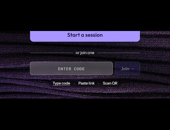
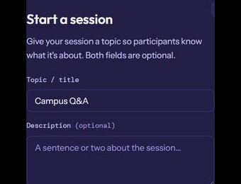
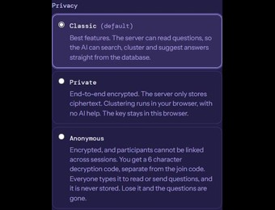
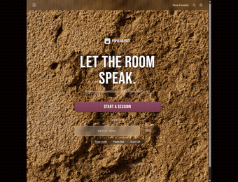
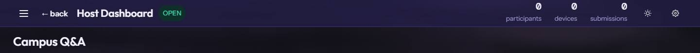
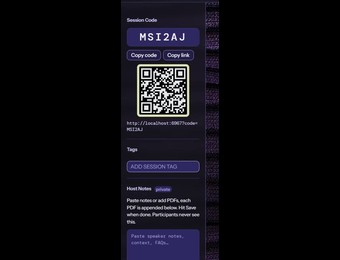
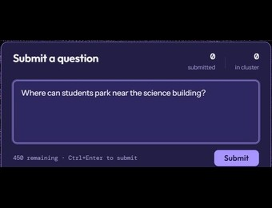
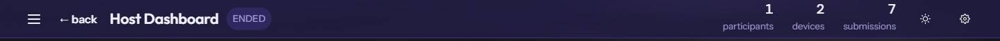
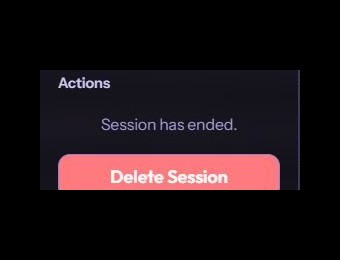

# CISC-4900-PopularVote

## Project overview
PopularVote is a web application for anonymous question submission and real-time clustering. A session host gathers questions from a group, the app groups the questions by topic using AI, and the host answers the grouped questions.

## Core functionality
A participant submits a question without an account and without giving a name. The app groups similar submissions into clusters using Google Gemini, and the host or a promoted curator answers each cluster. Participants can upvote a question and see responses live over a WebSocket connection, so everyone sees the same state as it changes.

A host can also upload notes as a PDF before or during a session. The app uses the notes to suggest answers and to run a chat flow, a form of retrieval augmented generation (RAG) where the model answers from the uploaded notes instead of from general knowledge alone.

Each session picks one of three privacy levels when it starts. In a Classic session, the server can read the questions, so the AI can cluster them and suggest answers. In a Private session, the questions and the clustering stay in the participant's and host's browsers, and the server only relays ciphertext it cannot read. In an Anonymous session, the session is private in the same way, and each participant is also reduced to a hash that is different in every session, so nobody can link one person's questions across two sessions. The host shares a 6 character decryption code for participants to unlock the room.

After a session ends, the host can download a PDF summary of the results.

## Screenshots
All screenshots are in dark mode. Most of them below are small crops of one part of the screen, each paired with a short note on what that part does, instead of a full screen for every step.

<table>
<tr>
<td width="240"></td>
<td>

**Landing page header.** A menu icon sits on the left. On the right, a "How it works" link sits next to a light and dark theme toggle and a settings gear.

</td>
</tr>
<tr>
<td width="240"></td>
<td>

**Landing page, start or join.** The "Start a session" button sits above a thin "or join one" divider. Under it sits a code entry box next to a "Join" button, and three links for the three ways to arrive at a room: "Type code", "Paste link", and "Scan QR".

</td>
</tr>
<tr>
<td width="240"></td>
<td>

**Starting a session, the fields.** A "Topic / title" field holds the session name, for example "Campus Q&A". A "Description" field under it is optional, for a sentence or two about the session.

</td>
</tr>
<tr>
<td width="240"></td>
<td>

**Starting a session, the privacy options.** The three levels read from least private to most private. Classic, the default, tells the host the server can read every question, which is also why it has the best features, since the AI can search and cluster the questions directly. Private tells the host the session is end to end encrypted, the server only stores ciphertext it cannot read, and clustering runs in the browser instead, with no AI help. Anonymous adds that participants cannot be linked across sessions, with a 6 character decryption code the host must share separately from the join code.

</td>
</tr>
<tr>
<td width="240"></td>
<td>

**Creating a session (live demo).** The host clicks "Start a session" on the landing page, which opens a short form: a "Topic / title" field, an optional description, and the three privacy levels as radio buttons. Classic is already selected by default, so for a quick session the host only has to type a topic and click "Create session" at the bottom, no privacy decision required. The server creates the session right away and hands back a short code; the page swaps straight to the host dashboard showing that code in large letters, its QR version, and the copy-code and copy-link buttons, all within about a second of clicking, with no extra confirmation step in between.

</td>
</tr>
<tr>
<td width="240"></td>
<td>

**Host dashboard header.** The title reads "Host Dashboard" next to a status badge, "OPEN" here, and three live counters for participants, devices, and submissions. The session name sits on the row under it.

</td>
</tr>
<tr>
<td width="240"></td>
<td>

**Host dashboard sidebar.** The session code sits in large letters above a "Copy code" and a "Copy link" button, then a QR code and the same join link written out under it. Lower down, a "Tags" field adds a tag to the session, and a "Host Notes" box holds private notes or pasted PDF text that participants never see.

</td>
</tr>
<tr>
<td width="240"></td>
<td>

**Joining a session (live demo).** A participant who has the code, scanned from the QR or typed by hand, lands on the same page and sees a single "Enter code" box next to a "Join" button where the host instead sees "Start a session". Typing the code and clicking "Join" sends it to the server, which checks that a session with that code actually exists and is still open, then drops the participant straight into the submission screen for that exact session. No account, email, or password is ever asked for, matching the no-login design described earlier in this README.

</td>
</tr>
<tr>
<td width="240"></td>
<td>

**Participant view header.** The title reads "Participant" next to the same status badge the host sees, and the session code sits on the right instead of the live counters.

</td>
</tr>
<tr>
<td width="240"></td>
<td>

**Submitting a question.** The card title reads "Submit a question" next to two small counters, one for how many questions have been submitted so far and one for how many have already landed in a cluster. The main box is where the participant types, with a character count and a reminder that Ctrl+Enter also submits, next to the "Submit" button.

</td>
</tr>
<tr>
<td width="260"></td>
<td>

**Cluster toolbar.** A small bar above the cluster cards shows the cluster count and the total number of submissions, next to two sort options, "Original" and "By popularity".

</td>
</tr>
<tr>
<td width="240"></td>
<td>

**A cluster card.** Each card shows a short topic sentence the AI wrote for that group of questions, how many submissions landed in it, a "Show N questions" control to expand the individual questions, and a response box where the host can type an answer for everyone in that cluster to see.

</td>
</tr>
<tr>
<td width="240"></td>
<td>

**Anonymous session decryption code.** A panel on the host dashboard shows the 6 character decryption code in large boxed letters, a line explaining that the host must give this code to participants along with the join code, and a warning that the code is never stored, so losing it scrambles the questions for good. Two buttons under it let the host copy the code or mark that they have saved it.

</td>
</tr>
<tr>
<td width="240"></td>
<td>

**Session summary header.** The status badge now reads "ENDED" instead of "OPEN", in the same header row as before.

</td>
</tr>
<tr>
<td width="240"></td>
<td>

**Session summary sidebar.** Once a session ends, the sidebar gains an "Actions" section with the line "Session has ended" and a red "Delete Session" button.

</td>
</tr>
<tr>
<td width="240"></td>
<td>

**Session summary export.** The main area reads "Session Summary" with the cluster and submission counts, next to "Markdown" and "PDF" export buttons. The cluster cards below are the same ones from before, now numbered and listing each "Top questions" instead of the editable response box, since the session is over and nothing more can be answered.

</td>
</tr>
</table>

## Technology
The repository is split into `src/frontend` and `src/backend`.

The frontend uses React 19 and Vite, with `socket.io-client` for live updates, `@supabase/supabase-js` for the database connection, `html5-qrcode` and `qrcode` for QR code session joins, and `jspdf` for the PDF export.

The backend uses Python and Flask, with `Flask-SocketIO` running on `eventlet` for the live events, `Flask-Limiter` for rate limiting, `google-genai` for the clustering and chat features, and `pypdf` to read the host's uploaded notes. The backend runs in production under `gunicorn`.

The database is PostgreSQL through Supabase, and it stores sessions, submissions, and clusters. The backend keeps an in-memory cache that it reads from and writes through to the database, so the database stays the source of truth.

The schema script and its notes are in `documents/design_documents/PostgreSQL Schema.sql` and `PostgreSQL Schema.md`.

The backend was first built on Node.js and Express, and it was later rewritten in Python and Flask so the AI tools, the PDF tools, and the WebSocket server could run on one runtime instead of two. The full design history and the reasoning behind that change are in `documents/design_documents/`.

## Deployment
The frontend deploys as a static build on Render's free tier, and the backend runs separately on Railway. Both run on a free or low-cost tier, so the first request after a period with no traffic can be slow while the service wakes back up.

## Getting started
First, clone the repository. Second, copy `src/backend/.env.example` to `src/backend/.env` and fill in the Supabase and Gemini credentials. Third, copy `src/frontend/.env.example` to `src/frontend/.env` and fill in the Supabase and API URL values. Fourth, install the backend dependencies from `src/backend/requirements.txt`, and install the frontend dependencies by running `npm install` in `src/frontend`. Fifth, run the backend with `app.py` and the frontend with `npm run dev`.

### Running with Docker
A multi-stage `Dockerfile` builds the Vite frontend and serves it from the Flask backend in one container.

First, fill in `src/backend/.env` as described above. Second, put `VITE_SUPABASE_URL` and `VITE_SUPABASE_ANON_KEY` in a `.env` file at the repo root, so Compose can pass them to the frontend build. Third, run `docker compose up --build` and open `http://localhost:6967`.

Host port `6967` maps to container port `2167`, because the CORS and Socket.IO allowlist in `src/backend/app.py` only permits `http://localhost:6967`. Keep the backend at one worker, because `SessionManager` holds the session state in memory, and a second worker would hold its own separate copy.

## Community
The project welcomes contributions, and it maintains a contribution guide. It is licensed under the GNU Affero General Public License v3, in `LICENSE`. Other legal notices are under `documents/legal/` and `documents/licenses/`.
